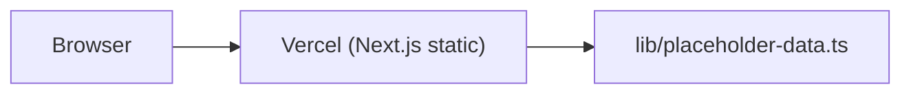
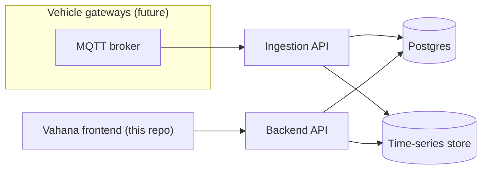

# Vahana — Architecture Vision (unbuilt)

**Status: design reference only.** Nothing described below exists in this repository or in any
provisioned infrastructure. The project owner confirmed on 2026-10-22 that only the frontend
is in scope right now — this document exists so a future backend phase has a starting point,
not because backend work has begun.

## Today

One deployable: the Next.js frontend, reading a hardcoded fixture file. No network boundary,
no database, no auth.

## Possible future shape

Candidate pieces, **not selected or committed to**:
- A TypeScript backend (Fastify or NestJS) with its own repository, separate from this one.
- Postgres for tenant/fleet/vehicle/alert/maintenance records.
- A separate ingestion path for telemetry volume, only added once real gateway volume
  justifies it — not provisioned speculatively.
- MQTT/Kafka only as an actual integration boundary when a real gateway exists to connect.

## Why nothing is provisioned yet

Every piece above has real cost and operational weight (a hosted database, a second deployable,
credentials to manage). None of it should be stood up without the project owner deciding to
move into a backend phase and approving the specific services involved — see
`docs/KNOWN_LIMITATIONS.md`.
